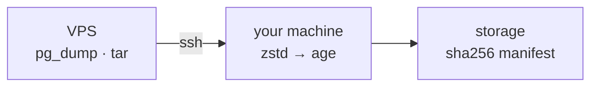

# bunker

bunker is a Go control/`orchestration:)` plane/`agent:)` for backing up multiple Server/VPS. It SSHes into your
server, runs `pg_dump -Fc` and `tar -cf -`, streams their stdout back to your
machine, then compresses (zstd), encrypts (age) and writes to local storage
with a SHA-256 per artifact in `manifest.json`.

The private key never leaves your machine, and the server only ever runs two
read-only commands.

## Build

    go build -o bunker ./cmd/bunker

## Run

    ./bunker backup run <server>

