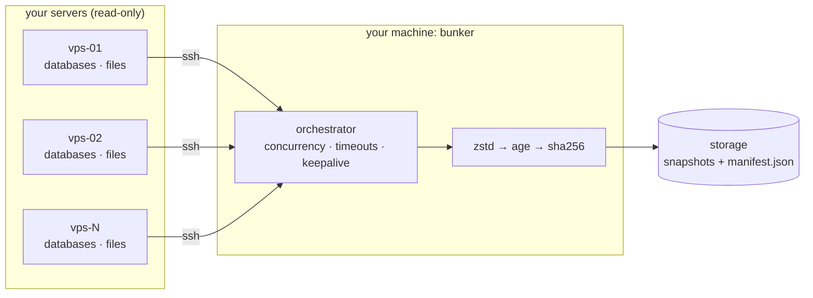

<p align="center">
  <picture>
    <source media="(prefers-color-scheme: dark)" srcset="docs/assets/images/bunker-white.png">
    
  </picture>
</p>
<h1 align="center">bunker</h1>

<p align="center">
  <b>A backup orchestrator for your fleet of servers.</b><br>
  One binary on your machine pulls encrypted, verified backups from all of them over SSH.
</p>

<p align="center">
  <a href="https://github.com/kushal1o1/bunker/actions/workflows/ci.yml"></a>
  <a href="https://github.com/kushal1o1/bunker/releases/latest"></a>
  <a href="LICENSE"></a>
  <a href="https://kushal1o1.github.io/bunker/"></a>
</p>

bunker backs up your databases and files from every server in one run. It
pulls them over SSH (read-only), then compresses, encrypts and checksums
everything on your machine. It does not reinvent backup tools. It orchestrates
them.




## Install

```bash
curl -LO https://github.com/kushal1o1/bunker/releases/latest/download/bunker-linux-amd64
chmod +x bunker-linux-amd64 && sudo mv bunker-linux-amd64 /usr/local/bin/bunker
```

macOS, Windows, checksums and `go install`: see
[Getting Started](https://kushal1o1.github.io/bunker/getting-started/).

## Quickstart

```yaml
# bunker.yaml
servers:
  web-01:
    host: 203.0.113.10
    ssh: { user: bunker }
    backup:
      postgres: { dbs: [shop_db] }
      paths: [/var/www/shop/media]
```

```bash
bunker keygen              # create the encryption key once
bunker backup run --all    # back up every server
bunker backup list         # see your snapshots
```

IPs in these docs (`192.0.2.x`, `198.51.100.x`, `203.0.113.x`) are reserved
documentation addresses ([RFC 5737](https://datatracker.ietf.org/doc/html/rfc5737)),
not real servers.

## Docs

<https://kushal1o1.github.io/bunker/>

## Development

```bash
go build -o bunker ./cmd/bunker && go test ./...
```

Issues and pull requests are welcome: see [CONTRIBUTING.md](CONTRIBUTING.md).
Security issues: see [SECURITY.md](SECURITY.md).

## License

[MIT](LICENSE)
