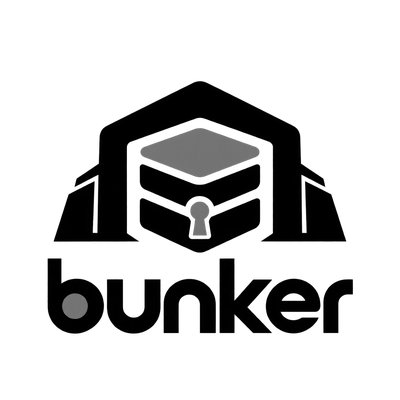
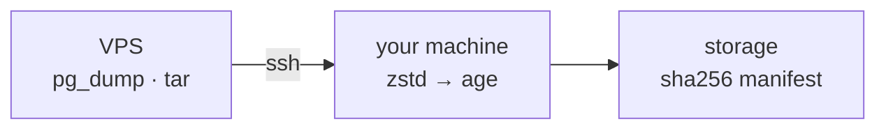

  <picture>
    <source media="(prefers-color-scheme: dark)" srcset="docs/assets/images/bunker-white.png">
    
  </picture>

<h1 align="center">bunker</h1>

bunker is a Go control/`orchestration:)` plane/`agent:)` for backing up multiple Server/VPS. It SSHes into your
server, runs `pg_dump -Fc` and `tar -cf -`, streams their stdout back to your
machine, then compresses (zstd), encrypts (age) and writes to local storage
with a SHA-256 per artifact in `manifest.json`.

The private key never leaves your machine, and the server only ever runs two
read-only commands.

Full documentation: <https://kushal1o1.github.io/bunker/> - walkthrough, command
reference, and configuration notes (generated from `docs/`).

## Install

Linux x86_64 (other systems, checksums and `go install`: see
[Getting Started](https://kushal1o1.github.io/bunker/getting-started/)):

    curl -LO https://github.com/kushal1o1/bunker/releases/latest/download/bunker-linux-amd64
    chmod +x bunker-linux-amd64
    sudo mv bunker-linux-amd64 /usr/local/bin/bunker
    bunker version

## Build

    go build -o bunker ./cmd/bunker

## Run

    ./bunker backup run <server>

## Docs (dev)

Docs are built with MkDocs Material from `docs/`. To work on them locally, in
your Python venv:

    pip install -r requirements.txt
    mkdocs serve    # http://127.0.0.1:8000/bunker/