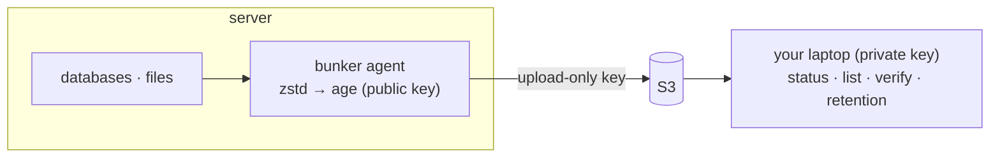
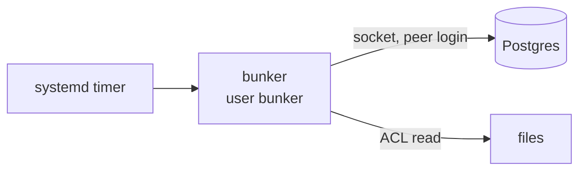
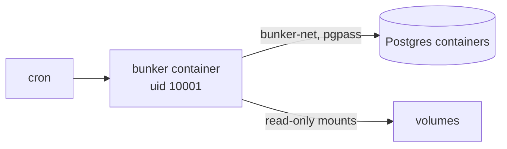

# Agent mode

Run bunker on the server itself. It backs the server up and pushes straight
to S3: no machine of yours has to be on, and nothing logs in to the server.

The agent holds only the age **public** key and an S3 key that can only
**upload**, so a hacked server can neither read nor delete old backups.
Verify, retention and restore stay on your laptop.



Two ways to run it, same binary:

**Host agent**: a systemd timer on a plain server.



**Container agent**: one container next to your Docker stacks. It covers
databases in containers and named volumes, without the Docker socket or root.



Agent mode runs on Linux servers. The laptop side (`status`, `list`, `verify`,
`retention`) works on Linux, macOS and Windows.

## 1. On your laptop

Print the public key the agent will encrypt to:

```bash
bunker keygen --public
```

Add the server to `bunker.yaml` as an agent, with the same S3 bucket and
prefix the agent will use:

```yaml
servers:
  web-01:
    agent: true

storage:
  s3:
    endpoint: https://s3.eu-central-1.amazonaws.com
    bucket: my-bunker
    prefix: prod/
```

## 2. An S3 key that can only upload

Give the agent its own key with this policy and nothing else:

```json
{
  "Version": "2012-10-17",
  "Statement": [{
    "Effect": "Allow",
    "Action": ["s3:PutObject", "s3:AbortMultipartUpload"],
    "Resource": "arn:aws:s3:::my-bunker/prod/*"
  }]
}
```

An upload key can still overwrite files. Turn on **bucket versioning** or
**Object Lock** so a hacked agent cannot destroy old snapshots by writing over
them.

### Where the keys go

bunker reads the keys from its environment, never from a `.env` file. Who sets
them depends on where it runs:

| Where | File | Read by |
|---|---|---|
| Host agent | `/etc/bunker/agent.env` | systemd |
| Container agent | `agent.env` next to `docker-compose.yml` | docker compose |
| Your laptop | any file you `source` | your shell |

`agent.env` is plain `KEY=value`, with no `export`:

```
AWS_ACCESS_KEY_ID=...
AWS_SECRET_ACCESS_KEY=...
```

On your laptop the lines need `export`, because the shell passes on only
exported variables: `source .env`, then run bunker.

## 3a. Host agent

The agent runs as a `bunker` user that can read only what you grant.
Ready-made files: [`examples/agent/host/`](https://github.com/kushal1o1/bunker/tree/main/examples/agent/host).

1. Create the user and grant read access to each path:

    ```bash
    sudo useradd --system --create-home bunker
    sudo setfacl -R -m u:bunker:rX /var/www/shop/media
    sudo setfacl -R -d -m u:bunker:rX /var/www/shop/media   # files created later
    ```

2. Give it a read-only database role. It logs in over the local socket as the
   OS user `bunker`, so no password is needed:

    ```sql
    CREATE ROLE bunker LOGIN;
    GRANT pg_read_all_data TO bunker;   -- Postgres 14+
    ```

3. Install the binary. Agent mode needs `v0.5.0` or later:

    ```bash
    VERSION=v0.5.0
    FILE=bunker-linux-amd64    # or bunker-linux-arm64 (uname -m prints aarch64)
    curl -LO https://github.com/kushal1o1/bunker/releases/download/$VERSION/$FILE
    curl -LO https://github.com/kushal1o1/bunker/releases/download/$VERSION/checksums.txt
    sha256sum --check --ignore-missing checksums.txt    # must print: OK
    sudo install -m 755 $FILE /usr/local/bin/bunker
    bunker --version
    ```

4. Write the config. Copy the examples, then edit them:

    ```bash
    BASE=https://raw.githubusercontent.com/kushal1o1/bunker/$VERSION/examples/agent/host
    sudo mkdir -p /etc/bunker
    sudo curl -fsSL -o /etc/bunker/agent.yaml $BASE/agent.yaml
    sudo curl -fsSL -o /etc/bunker/agent.env $BASE/agent.env.example
    sudo chmod 600 /etc/bunker/agent.env
    sudoedit /etc/bunker/agent.yaml    # name, dbs, paths, s3, recipient
    sudoedit /etc/bunker/agent.env     # the upload key
    ```

    Keep them outside home folders: the `bunker` user must read them, and home
    folders are usually closed to other users.

    ??? example "agent.yaml"

        The same file as [`examples/agent/host/agent.yaml`](https://github.com/kushal1o1/bunker/blob/main/examples/agent/host/agent.yaml); copy it from here or download it above.

        ```yaml
        # /etc/bunker/agent.yaml: what this server backs up, and where it goes.
        # No secrets here: the S3 key is in agent.env.

        agent:
          name: web-01                 # this server's folder in S3; the laptop uses the same name

        backup:
          postgres:
            - host: /var/run/postgresql   # the host's Postgres, over its socket (peer login, no password)
              dbs: [shop_db]
              user: bunker
          paths:
            - /var/www/shop/media         # needs: setfacl -R -m u:bunker:rX (and -d for new files)

        storage:
          s3:
            endpoint: https://s3.eu-central-1.amazonaws.com
            bucket: my-bunker
            region: eu-central-1
            prefix: prod/

        encryption:
          recipient: age1...              # from: bunker keygen --public (on the machine with the private key)
        ```

    ??? example "agent.env"

        The same file as [`examples/agent/host/agent.env.example`](https://github.com/kushal1o1/bunker/blob/main/examples/agent/host/agent.env.example); copy it from here or download it above.

        ```
        # /etc/bunker/agent.env (chmod 600, owner root)
        # An S3 key that can only upload: s3:PutObject and s3:AbortMultipartUpload.
        AWS_ACCESS_KEY_ID=
        AWS_SECRET_ACCESS_KEY=
        ```

5. Check as the service will run (same user, same `agent.env`):

    ```bash
    sudo systemd-run --pipe --wait -p User=bunker \
      -p EnvironmentFile=/etc/bunker/agent.env /usr/local/bin/bunker agent check
    ```

6. Schedule it. See the files first, then install:

    ```bash
    sudo bunker agent install --dry-run
    sudo bunker agent install              # every day at 03:00
    ```

    Another time with `--at` (24-hour, server local time):

    ```bash
    sudo bunker agent install --at 01:30
    sudo bunker agent install --at 23:00
    ```

    Run one now: `sudo systemctl start bunker-agent`, then
    `journalctl -u bunker-agent`.

### What install writes

??? example "/etc/systemd/system/bunker-agent.service"

    ```ini
    # Written by `bunker agent install`. Edit it freely; `bunker agent uninstall` removes it.
    [Unit]
    Description=bunker agent: back up this server to S3
    Wants=network-online.target
    After=network-online.target

    [Service]
    Type=oneshot
    User=bunker
    ExecStart=/usr/local/bin/bunker agent run -c /etc/bunker/agent.yaml
    # The upload-only S3 key. "-": a missing file is reported by the agent.
    EnvironmentFile=-/etc/bunker/agent.env
    NoNewPrivileges=yes
    ProtectSystem=strict
    ProtectHome=read-only
    PrivateTmp=yes
    ```

??? example "/etc/systemd/system/bunker-agent.timer"

    ```ini
    # Written by `bunker agent install`. Edit it freely; `bunker agent uninstall` removes it.
    [Unit]
    Description=Run the bunker agent every day at 03:00

    [Timer]
    OnCalendar=*-*-* 03:00:00
    # Run a missed backup after a reboot.
    Persistent=true
    # Spread servers out so they do not all upload at once.
    RandomizedDelaySec=10m

    [Install]
    WantedBy=timers.target
    ```

Edit them freely, for example `OnCalendar=*-*-* 03,15:00:00` for twice a day,
then run `sudo systemctl daemon-reload`. Or skip `install`: copy the same files
from the examples and run `sudo systemctl enable --now bunker-agent.timer`.

## 3b. Container agent

One agent container per server covers every project on it. Ready-made files:
[`examples/agent/docker/`](https://github.com/kushal1o1/bunker/tree/main/examples/agent/docker).

1. Create a network for backups and attach **only the databases** to it, not
   the apps. Keep their ports unpublished.

    ```bash
    docker network create bunker-net
    ```

    ```yaml
    # in each project's docker-compose.yml
    services:
      postgres:
        networks: [default, bunker-net]
    networks:
      bunker-net: { external: true }
    ```

2. Give each database a read-only role with a password:

    ```bash
    docker exec -it shop-postgres psql -U postgres -c \
      "CREATE ROLE bunker LOGIN PASSWORD 'long-random'; GRANT pg_read_all_data TO bunker;"
    ```

3. Get the example files into the agent folder (any path without spaces;
   these steps use `/opt/bunker-agent`):

    ```bash
    VERSION=v0.5.0
    BASE=https://raw.githubusercontent.com/kushal1o1/bunker/$VERSION/examples/agent/docker
    sudo mkdir -p /opt/bunker-agent && sudo chown $USER /opt/bunker-agent
    cd /opt/bunker-agent
    curl -fsSLO $BASE/docker-compose.yml
    curl -fsSLO $BASE/agent.yaml
    curl -fsSL -o agent.env $BASE/agent.env.example
    curl -fsSL -o pgpass $BASE/pgpass.example
    ```

    Then edit `agent.yaml`, the volumes and `group_add` in
    `docker-compose.yml`, and put one line per database in `pgpass`
    (`host:port:database:user:password`).

    ??? example "docker-compose.yml"

        The same file as [`examples/agent/docker/docker-compose.yml`](https://github.com/kushal1o1/bunker/blob/main/examples/agent/docker/docker-compose.yml); copy it from here or download it above.

        ```yaml
        # /opt/bunker-agent/docker-compose.yml
        # The agent runs once per `docker compose run` (see crontab.example). It has
        # no Docker socket, no capabilities and a read-only filesystem. It reads only
        # what is mounted here, and reaches only the databases on bunker-net.

        services:
          bunker-agent:
            image: ghcr.io/kushal1o1/bunker:v0.5.0
            command: agent run
            env_file: agent.env                # read by compose on the host, not by the container
            environment:
              PGPASSFILE: /run/secrets/pgpass
            secrets: [pgpass]
            networks: [bunker-net]
            read_only: true
            cap_drop: [ALL]
            security_opt: ["no-new-privileges:true"]
            # Join the group that owns the volume files (33 = www-data on Debian
            # images), so files like mode 640 can be read. No capability needed.
            group_add: ["33"]
            volumes:
              - ./agent.yaml:/etc/bunker/agent.yaml:ro
              - shop_uploads:/data/shop/uploads:ro

        secrets:
          pgpass:
            file: ./pgpass                     # chown 10001 pgpass && chmod 600 pgpass

        volumes:
          shop_uploads:
            external: true                     # the app's volume: docker volume ls

        networks:
          bunker-net:
            external: true                     # docker network create bunker-net
        ```

    ??? example "agent.yaml"

        The same file as [`examples/agent/docker/agent.yaml`](https://github.com/kushal1o1/bunker/blob/main/examples/agent/docker/agent.yaml); copy it from here or download it above.

        ```yaml
        # /opt/bunker-agent/agent.yaml: what this server backs up, and where it goes.
        # No secrets here: the S3 key is in agent.env, DB passwords in pgpass.

        agent:
          name: web-01                 # this server's folder in S3; the laptop uses the same name

        backup:
          postgres:
            - host: shop-postgres      # a database container on bunker-net
              dbs: [app]
              user: bunker
            - host: blog-db
              dbs: [app]
              user: bunker
          paths:
            - /data/shop/uploads       # a volume, mounted read-only in docker-compose.yml

        storage:
          s3:
            endpoint: https://s3.eu-central-1.amazonaws.com
            bucket: my-bunker
            region: eu-central-1
            prefix: prod/

        encryption:
          recipient: age1...           # from: bunker keygen --public (on the machine with the private key)
        ```

    ??? example "pgpass"

        The same file as [`examples/agent/docker/pgpass.example`](https://github.com/kushal1o1/bunker/blob/main/examples/agent/docker/pgpass.example); copy it from here or download it above.

        ```
        # /opt/bunker-agent/pgpass: host:port:database:user:password, one line per database server.
        # chmod 600 pgpass && sudo chown 10001 pgpass  (the agent runs as uid 10001 and must read it;
        # pg_dump ignores a pgpass others can read). Remove these comment lines or keep them: pg_dump skips #.
        shop-postgres:5432:*:bunker:change-me
        blog-db:5432:*:bunker:change-me-too
        ```

    ??? example "agent.env"

        The same file as [`examples/agent/docker/agent.env.example`](https://github.com/kushal1o1/bunker/blob/main/examples/agent/docker/agent.env.example); copy it from here or download it above.

        ```
        # /opt/bunker-agent/agent.env (chmod 600, owned by the admin: compose reads it on the host)
        # An S3 key that can only upload: s3:PutObject and s3:AbortMultipartUpload.
        AWS_ACCESS_KEY_ID=
        AWS_SECRET_ACCESS_KEY=
        ```

4. Set the owners. `pgpass` is read inside the container (uid `10001`);
   `agent.env` is read by `docker compose` on the host, so it stays yours:

    ```bash
    chmod 600 pgpass agent.env
    sudo chown 10001 pgpass      # last: after this, only uid 10001 and root can change it
    ```

5. Check:

    ```bash
    docker compose run --rm bunker-agent agent check
    ```

6. Schedule it. The container runs one backup and exits, so the host's cron
   starts it every day. (A scheduler container would need the Docker socket,
   which the agent never gets.)

    **With bunker on the host:**

    ```bash
    sudo bunker agent install --docker /opt/bunker-agent --dry-run
    sudo bunker agent install --docker /opt/bunker-agent --at 01:30
    ```

    **Docker only, without bunker on the host:** write the same file yourself:

    ```bash
    echo '0 3 * * * root cd /opt/bunker-agent && flock -n /run/bunker-agent.lock docker compose run --rm bunker-agent >> /var/log/bunker-agent.log 2>&1' \
      | sudo tee /etc/cron.d/bunker-agent
    ```

    The first two fields are minute and hour: `30 1` runs at 01:30.

### Reading files owned by other users

Volume files often belong to the app's user, for example `www-data` with mode
`640`. Add that group to the agent with `group_add` (`"33"` is `www-data` on
Debian images). The agent then reads them as a group member, with no extra
capabilities.

Files only their owner can read (mode `600`) cannot be backed up this way;
`agent check` names them.

## What the agent can and cannot do

| It has | It never has |
|---|---|
| the age public key | the private key |
| an upload-only S3 key | S3 read or delete |
| read-only database roles | database write |
| read access to what you grant or mount | root, the Docker socket, capabilities |
| outbound connections to S3 | a listening port |

## Removing it

```bash
sudo bunker agent uninstall
```

It disables the timer and removes the service, timer or cron file.
`agent.yaml`, `agent.env` and your snapshots in S3 stay.

Without bunker on the host: `sudo rm /etc/cron.d/bunker-agent`.

## Checking on it

- `bunker status` on your laptop shows each agent's last run and newest
  snapshot, and exits `1` when one needs attention.
- On the server: `journalctl -u bunker-agent` (host) or
  `/var/log/bunker-agent.log` (container).
- A run that dies halfway leaves files without `manifest.json` (an upload key
  cannot delete them). They never count as a backup, and `retention apply
  --yes` on your laptop removes them after a day.
- `--at` and cron use the server's local time (`timedatectl` shows it).
  Snapshot names and log times are UTC. For example, a 03:00 run in Nepal
  (UTC+5:45) is named `...T21-15-00` of the day before.

See [`agent run`](COMMANDS.md#agent-run), [`agent check`](COMMANDS.md#agent-check)
and [`status`](COMMANDS.md#status) for every option.
