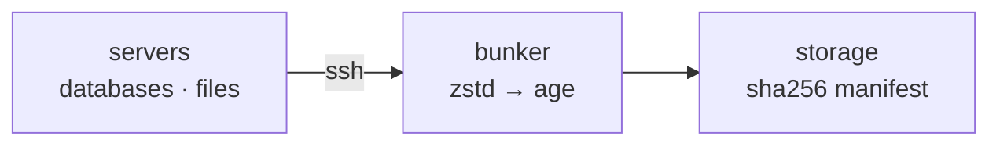

<p align="center">
  
  
</p>

# bunker

**A backup orchestrator for your fleet of servers.** One binary on your machine
pulls encrypted, verified backups from all of them over SSH. Nothing to install
on the servers.

bunker backs up your databases and files from every server in one run. It does
not reinvent backup tools. It orchestrates them and handles the rest: many
servers in parallel, timeouts, encryption, verification and retention.



## How it works

1. Run a read-only command on the server (`pg_dump -Fc` or `tar`).
2. Stream it through zstd and age into a file on your machine.
3. Record each file's SHA-256 in `manifest.json`. Without it, the snapshot is
   incomplete.

```
~/backups/
  my-vps/
    2026-10-17T09-12-03/
      manifest.json
      postgres/mydb.dump.zst.age
      files/var-www-uploads.tar.zst.age
```

## Quickstart

```bash
bunker keygen                       # create the encryption key once
# edit bunker.yaml: one server, a database or a path
bunker backup run my-vps            # take a snapshot
bunker backup verify my-vps 2026-10-17T09-12-03   # prove it is readable
```

Today: PostgreSQL and files to local disk. Next: S3, restore, more databases.

## Docs

- [Getting Started](getting-started.md) - install and your first backup
- [Configuration](configuration.md) - every `bunker.yaml` field
- [Retention](retention.md) - pruning old snapshots
- [Commands](COMMANDS.md) - full command reference
- [Roadmap](roadmap.md) - what is done and what is next
