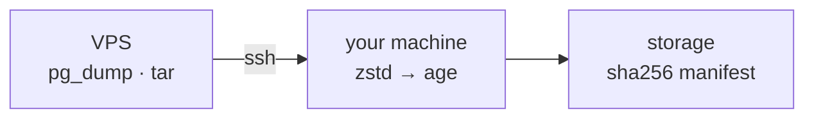

<p align="center">
  
  
</p>

# bunker

bunker backs up PostgreSQL databases and file paths from one or more servers
over SSH. It streams `pg_dump` and `tar` output to your machine, compresses it
(zstd), encrypts it (age), and stores it locally with a SHA-256 checksum per
artifact in `manifest.json`.

The private key never leaves your machine, and the server only ever runs two
read-only commands.



## Quickstart

```bash
bunker keygen                       # create the encryption key once
# edit bunker.yaml: one server, a database or a path
bunker backup run my-vps            # stream pg_dump | zstd | age to disk
bunker backup verify my-vps 2026-10-08T13-32-59   # prove it's readable
```

## Docs

- [Getting Started](getting-started.md) - install, configure one server, take your first backup
- [Commands](COMMANDS.md) - full command reference
- [Example config](https://github.com/kushal1o1/bunker/blob/main/examples/bunker.yaml)